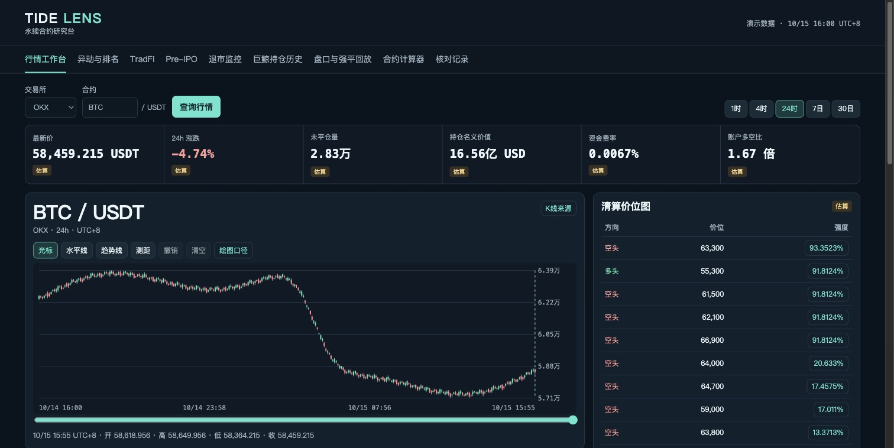
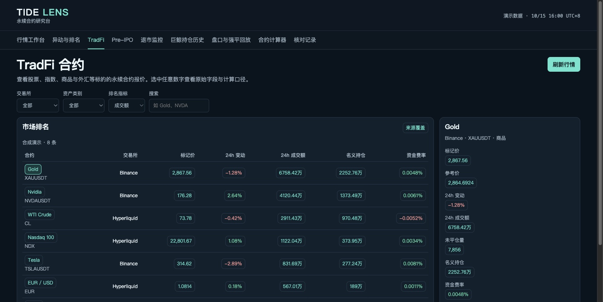

<div align="center">

# Tide Lens

**An evidence-first perpetual futures workbench for DeepSeek Harness.**

[English](README.en.md) · [简体中文](README.md) · [Download](https://github.com/shanghe000/tide-lens-harness/releases/latest) · [Data coverage](docs/coverage.en.md)

[](https://github.com/shanghe000/tide-lens-harness/releases/latest)
[](https://github.com/shanghe000/tide-lens-harness/actions/workflows/test.yml)
[](LICENSE)



<sub>Actual product screenshot using the bundled synthetic demo series.</sub>

</div>

## Explore a move and inspect the evidence

| Workspace | What you can do |
| --- | --- |
| **Market workbench** | Compare candles, open interest, funding, account ratios, and sampled trades across OKX, Binance, and Bybit. Overlay modeled liquidation levels. Save horizontal lines, trends, and measurements by exchange and symbol. |
| **Wallet position history** | Enter a public Hyperliquid address. Inspect current positions, fills, and funding over a 24-hour to seven-day window. See reconstructed signed positions and explicit gaps. |
| **Order book and liquidation replay** | Start a local recording, scrub recorded snapshots and public liquidation disclosures, and inspect their sources. Import or export recordings as NDJSON. |
| **Evidence review** | Open individual values to see timestamps, units, and methods. The Harness analysis tool only reads facts you have confirmed. |
| **TradFi** | Browse perpetuals referencing equities, indices, commodities, FX, and rates by venue and category. |
| **Pre-IPO** | Track contracts labeled pre-IPO by their venue. Inspect implied value only where a published conversion basis is available. |
| **Delisting watch** | Filter official notices and contract schedules by venue, market, stage, and lookback window. |
| **Screening and calculators** | Rank markets, save a local watchlist and thresholds, and estimate isolated-position P&L, funding, liquidation, and risk size. |

<details>
<summary>See the v0.3 market watch</summary>



<sub>Actual product screenshot using synthetic demo data.</sub>

</details>

## Install on DeepSeek Harness Web

Required **Node.js 24.9+**, **pnpm**, and **DeepSeek Harness Web 0.2.2-rc.1**.

1. Download `dsh-tide-lens-0.3.0.tgz` from [GitHub Releases](https://github.com/shanghe000/tide-lens-harness/releases/latest).
2. Install it from the download directory and start Harness.

   ```sh
   npx @deepseek-ai/dsh@0.2.2-rc.1 plugin --profile web add ./dsh-tide-lens-0.3.0.tgz
   npx @deepseek-ai/dsh@0.2.2-rc.1 web
   ```

3. Choose **Tide Lens** in the Harness sidebar. The same install command upgrades an existing copy. The browser and Harness host must run on the same machine. The workbench interface currently uses Simplified Chinese.

## First session

- **Annotate a chart.** Select a trend line or measurement and place two anchors. Keyboard users can move the cursor with arrows, place anchors with Enter, and cancel with Escape.
- **Inspect a wallet.** Enter a public Hyperliquid address, choose a time window, and open a post-fill position to inspect the starting size, fill direction, quantity, and reconstruction formula.
- **Record and replay.** Pick an exchange and symbol, then start recording. After a few samples, stop and scrub the timeline. Open individual levels or liquidation values for source details.
- **Verify a market event.** Open its venue notice in Delisting Watch and compare publication and effective times. Inspect each TradFi or Pre-IPO value for units and calculation details.
- **Analyze confirmed facts.** Review evidence in the panel and ask Harness to compare the confirmed readings in time order. A Harness model must be configured for chat-based analysis.

## Data boundaries

Wallet history covers the main Hyperliquid perpetuals venue within its published retention and pagination limits. Order books are sampled and liquidation disclosures depend on each venue and stream availability. Imports are marked unverified and excluded from the confirmed analysis queue. TradFi and Pre-IPO values are derivative contract quotes. Implied values require an explicit conversion basis. Delisting coverage follows public venue data, with temporary suspensions and monitoring tags excluded. See [coverage and methodology](docs/coverage.en.md) for the data sources, gaps, and formulas.

The repository and installer ship source code. The homepage screenshot uses synthetic demo data. Live market data remains subject to provider terms. Reviews, drawings, and recordings stay on the local machine. Set `TIDE_LENS_REVIEW_DIR` to change their location.

## Development and offline demo

```sh
npm run demo   # start the workbench with synthetic market data
npm start      # use live public endpoints
npm test
npm pack
```

Configure `HTTPS_PROXY`, `HTTP_PROXY`, `NO_PROXY`, and `NODE_USE_ENV_PROXY=1` if your network requires a proxy. The standalone demo needs no Harness login.

[Contributing](CONTRIBUTING.md) · [Issues](https://github.com/shanghe000/tide-lens-harness/issues) · [Security](SECURITY.md) · [MIT license](LICENSE)
