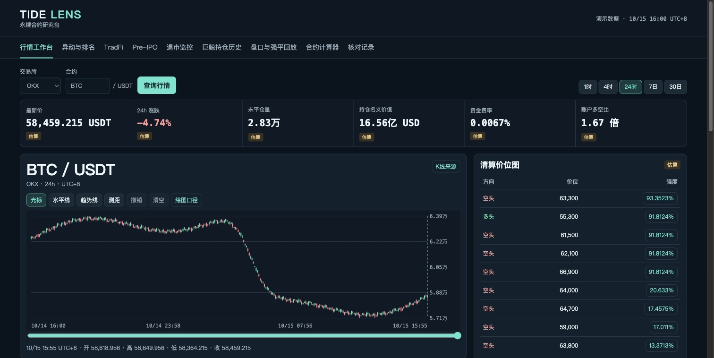
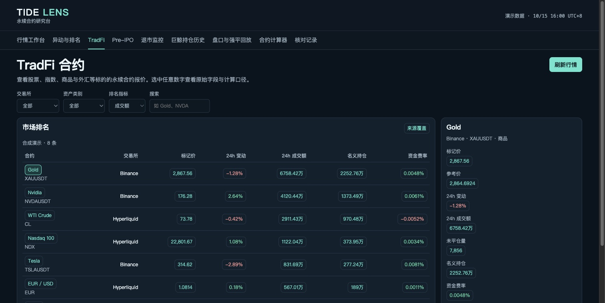

<div align="center">

# Tide Lens · 行情透镜

**在 DeepSeek Harness 里研究永续合约，把每个关键数字追溯到来源。**

[简体中文](README.md) · [English](README.en.md) · [下载插件](https://github.com/shanghe000/tide-lens-harness/releases/latest) · [数据覆盖](docs/coverage.md)

[](https://github.com/shanghe000/tide-lens-harness/releases/latest)
[](https://github.com/shanghe000/tide-lens-harness/actions/workflows/test.yml)
[](LICENSE)



<sub>实际界面截图，使用项目内的合成演示数据。</sub>

</div>

## 从盘面到证据

| 工作区 | 可以做什么 |
| --- | --- |
| **行情工作台** | 在 OKX、Binance 或 Bybit 的永续合约上联动查看 K 线、持仓、资金费率、账户多空比、成交样本和估算清算热图。添加水平线、趋势线或测距，按交易所与币种保存。 |
| **巨鲸持仓历史** | 输入 Hyperliquid 公开地址，查看当前仓位、最近 24 小时至 7 天内的成交与资金费。用成交前仓位和方向重建净仓位，保留断点。 |
| **盘口与强平回放** | 主动录制盘口快照和公开强平样本。按时间拖动、逐帧播放并核对原始口径。支持本机 NDJSON 导入和导出。 |
| **核对与分析** | 点开指标、档位或事件查看数据、时间、单位和计算方法。只有你确认的记录才交给 Harness 分析工具。 |
| **TradFi** | 按资产类别和交易所浏览股票、指数、商品、外汇及利率永续合约。 |
| **Pre-IPO** | 按交易场所实时分类查看上市前合约。条款给出明确换算基准时，可核对隐含估值。 |
| **退市监控** | 按交易所、市场、状态与时间窗口查找退市公告和可验证的生效时间。 |
| **筛选与计算** | 按持仓、成交、费率或涨跌排名，设本地关注和阈值提醒，估算逐仓收益、资金费、强平价及风险仓位。 |

<details>
<summary>查看 v0.3 的市场观察界面</summary>



<sub>实际界面截图，使用合成演示数据。</sub>

</details>

## 安装到 DeepSeek Harness Web

需要 **Node.js 24.9+**、**pnpm** 和 **DeepSeek Harness Web 0.2.2-rc.1**。

1. 从 [发布页](https://github.com/shanghe000/tide-lens-harness/releases/latest) 下载 `dsh-tide-lens-0.3.0.tgz`。
2. 在下载目录安装并启动。

   ```sh
   npx @deepseek-ai/dsh@0.2.2-rc.1 plugin --profile web add ./dsh-tide-lens-0.3.0.tgz
   npx @deepseek-ai/dsh@0.2.2-rc.1 web
   ```

3. 点击 Harness 左侧 **Tide Lens**。旧版可用同一条安装命令升级。浏览器与 Harness 宿主须在同一台机器。

## 第一次使用

- **画图。** 在行情页选「趋势线」或「测距」，点两个时间和价格锚点。也可以用方向键定位、Enter 固定、Escape 取消。
- **看持仓。** 在「巨鲸持仓历史」输入公开地址。点开某笔成交后的仓位，查看 `startPosition`、成交方向、数量和公式。资金费读取独立流水。
- **录一段回放。** 选交易所和币种，点击「开始录制」，等待至少两次采样后停止。拖动时间轴，点击盘口或强平数值查看来源。
- **核对市场事件。** 在「退市监控」按状态与市场筛选，打开官方公告。生效时间和公告时间分开展示，缺失时间保留待核实；TradFi 和 Pre-IPO 的每个数字都可查看单位与来源。
- **让 Harness 分析。** 核对后在对话中输入「只根据 Tide Lens 已确认的记录，对照时间、价格和持仓列出观察」。对话工具需要已经可用的 Harness 模型。

## 数据边界

地址历史覆盖 Hyperliquid 主永续市场的可见成交。它保留官方分页限制、推算断点和缺失值。盘口是定时采样，强平受各交易所的披露范围和连接状态限制。导入文件标为待核实，数据可查看，但无法进入已确认分析。TradFi 和 Pre-IPO 展示衍生品报价。隐含估值只随可解释的换算条款出现。退市监控覆盖公开来源，停牌和监控标签不算退市。计算公式和各交易所口径见 [数据覆盖表](docs/coverage.md)。

仓库、安装包和首页截图均使用自有代码或合成数据。运行时交易所数据受提供者条款约束。核对记录、绘图和录制文件保存在本机，可通过 `TIDE_LENS_REVIEW_DIR` 更改位置。

## 开发与演示

```sh
npm run demo   # 无需联网，用合成行情启动工作台
npm start      # 使用实时公开数据
npm test
npm pack
```

打不开交易所时，可为 Node.js 设置 `HTTPS_PROXY`、`HTTP_PROXY`、`NO_PROXY` 与 `NODE_USE_ENV_PROXY=1`。独立演示无需 Harness 登录。

[贡献指南](CONTRIBUTING.md) · [问题反馈](https://github.com/shanghe000/tide-lens-harness/issues) · [安全报告](SECURITY.md) · [MIT 许可](LICENSE)
